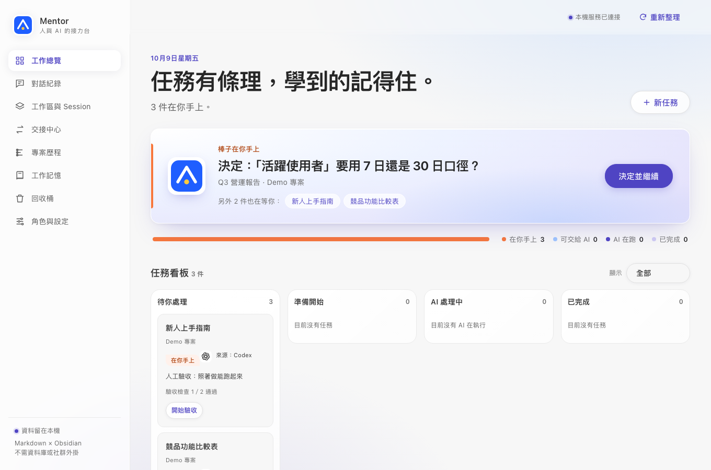

<div align="center">


# Mentor

**Hand work between Codex, Claude Code and Copilot without re-explaining anything. Then actually remember what you learned.**

A zero-dependency local workbench. One task file is the source of truth: the AI reads it before it starts, writes back when it stops, and you only decide and review.

[](https://github.com/dan40912/mentor/actions/workflows/ci.yml)
[](LICENSE)


English · [繁體中文](README.zh-TW.md)



</div>

> **Status: early (v0.1).** The task file, decision cards, handoff brief, verification and the A–F coaching flow work and are tested. The web UI is **Traditional Chinese only for now** (English UI is on the [roadmap](#roadmap)). Automatic switch-over when a quota runs out is **not built yet**; today you hand off with one click, not zero clicks.

## The problem

You work with more than one AI agent. One hits its usage limit halfway through. You open another and spend ten minutes re-explaining the project, hunting for which file is the latest, and guessing what was already decided. Meanwhile a decision that only you can make is buried in a chat, an AI quietly picked a default, and "exit code 0" got mistaken for "done".

Mentor takes you out of the courier role.

## What you get

| | |
|---|---|
| **One task file** | A Markdown file (Obsidian-friendly) holds the goal, boundaries, decisions, evidence and the single next step. Any agent can pick it up. |
| **Handoff in one click** | `GET /api/tasks/:id/brief?for=codex\|claude` builds a brief under 8,000 characters: boundaries, confirmed decisions, open questions, agreed numbers, report format. No chat history needed. |
| **You decide, AI does** | Decisions are separate cards with a recommendation, the cost of each option, and what is unknown. "Ask someone else" stays blocked until a real answer is recorded. An AI cannot pick a default for you. |
| **Evidence, not vibes** | Artifact checks compute SHA-256 on the file. If you edit a file yourself, that is a new baseline. Reports built on a stale revision are rejected. `DONE` only means "ready for review". |
| **A coach, not just a runner** | Stages A–F (task card → Grill me → outline → execute → review → revise) with a different permission level each: chat-only, read-only, or write-in-the-output-folder. |
| **Feedback that steers** | When you confirm a result, when autopilot stops, and when a task ends, Mentor asks one 1–5 question with tags. Low scores become directions the AI reads at the start of the next task, and you see the trend on the home page. |
| **Learning that sticks** | After each step the AI writes a diary: interpretations, deviations, trade-offs. You tick what to keep. Kept rules go into the next task, and come back as spaced recall questions. |
| **Zero dependencies** | Plain Node.js and vanilla JS. No `npm install`, no database, no Obsidian plugin. |

## Quick start

Requires Node.js 20 or newer (tested on 20, 22 and 24) on macOS, Linux or Windows, and at least one logged-in CLI if you want Mentor to run agents ([Codex](https://github.com/openai/codex), [Claude Code](https://claude.com/claude-code) or GitHub Copilot CLI). Without a CLI you can still use the task file and manual handoff.

```sh
git clone https://github.com/dan40912/mentor.git
cd mentor
npm run demo      # seeds a fictional vault in .demo-home/ and starts the server
```

Open <http://127.0.0.1:4317>. When you want your own data:

```sh
npm start                                  # data goes in ./vault and ./outputs (git-ignored)
npm start -- --home ~/mentor-data          # keep data anywhere else
npm start -- --port 4318                   # if 4317 is taken
npm test
```

`--home` and `--port` work the same in macOS, Linux, PowerShell and cmd. The `MENTOR_HOME` and `PORT` environment variables also work.

### Windows notes

- CLIs installed with npm (for example `codex`) are `.cmd` shims on Windows. Mentor finds them through `PATH` and `PATHEXT` and runs them through `cmd.exe`. Arguments containing `& | < > ^ % ! "` are refused instead of escaped, so keep your project and output paths free of those characters.
- Stopping a run ends the whole process tree with `taskkill`.
- Windows runs in CI on every push. It has not yet been tried with a real logged-in `codex`, `claude` or `copilot` on a Windows machine, so please report anything odd.

## How it works

```
task file ──generate──▶ handoff brief (≤ 8,000 chars) ──paste or run──▶ Codex / Claude / Copilot
   ▲                                                                           │
   └──── server checks revision, evidence and new artifact hash ◀── report ────┘
```

1. **Create** a task in the UI. The coach turns one sentence into a task card and asks at most three questions at a time.
2. **Assign** a provider and model per stage. Mentor calls the CLI you are already logged in to, through `argv` and `stdin`, never through a shell.
3. **Decide.** The home page shows exactly one thing for you: pending decision, then failed check, then waiting review, then manual check, then "give it to the AI".
4. **Hand off.** Quota gone, or a different model is better for the next step? Switch provider; the brief carries everything.
5. **Review.** Auto checks and your manual checks are separate. AI-verified is never the same as you-verified.
6. **Keep.** Tick the lessons worth keeping. They shape the next task in the same project.

See [`examples/sample-task.md`](examples/sample-task.md) for what a task file looks like, and [`docs/architecture.md`](docs/architecture.md) for the internals.

## Security model

Mentor runs on your machine and executes CLIs you already trust, so the defaults are strict.

- Binds to loopback only; checks `Host` and `Origin`.
- State-changing requests need a same-origin cookie, a CSRF token and an `Idempotency-Key`. The same key used for a different action is rejected.
- Never passes any "bypass permissions" flag to any CLI. Stages get the least access they need: chat-only, read-only, or write inside the task's output folder. Enforcement depends on the CLI (Codex uses its sandbox; Claude Code and Copilot use tool allow-lists plus the working directory, with no extra sandbox from Mentor).
- Preview and file reads are path-checked and symlink-checked.
- Restarting marks unfinished steps as "unknown" instead of silently re-running them.

Found a hole? See [SECURITY.md](SECURITY.md).

## How it differs

| Category | Typical focus | Mentor's focus |
|---|---|---|
| Single coding agent | Do the task in one session | Carry the task *between* sessions and agents |
| Agent orchestrators | Run many agents in parallel | One human-owned task file, one next step, explicit decisions |
| Chat history tools | Search past conversations | Turn mistakes into rules the next task actually reads |

Mentor is not trying to replace your agent. It is the layer where your agents hand off and you stay in charge.

## Roadmap

**Works today:** task file as source of truth, decisions, evidence checks, handoff brief, A–F controlled CLI flow, kanban, learning diary and recall, trash with restore, project briefs.

**Next:**
- [ ] English UI (i18n for the web app and coach prompts)
- [ ] Auto handoff when a provider reports a quota error
- [ ] Session importers for Codex and Claude Code logs (today the import is manual)
- [ ] Server-sent events instead of refresh
- [ ] Demo GIF of a full Claude → Codex handoff
- [ ] `npx mentor-ai`

Have an idea? [Open an issue](https://github.com/dan40912/mentor/issues/new/choose).

## Docs

- [Design intent](docs/design-intent.md): why the task file, decisions and evidence are the only three objects
- [Architecture](docs/architecture.md)
- [Tutorial 1: first task in 5 minutes](docs/tutorials/01-first-task.md)
- [Tutorial 2: hand one task across two AIs](docs/tutorials/02-handoff.md)
- [Tutorial 3: turn mistakes into rules](docs/tutorials/03-learning.md)
- [Notes on AI-DLC](docs/ai-dlc-notes.md): what we borrowed and what we deliberately skipped

## Contributing

Issues and PRs are welcome. Start with [CONTRIBUTING.md](CONTRIBUTING.md). The most useful contribution right now is translating the UI.

## License

[MIT](LICENSE)
