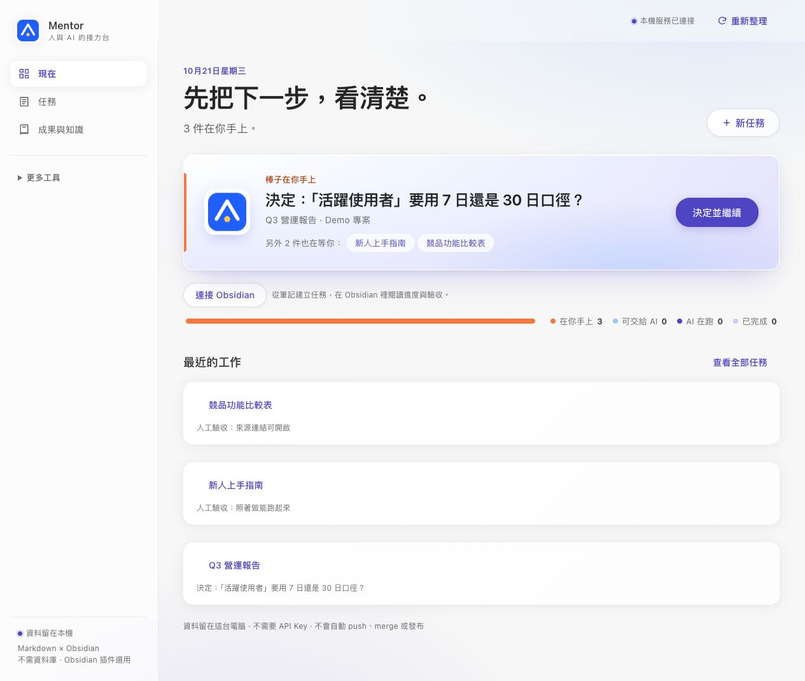

# Mentor

把一件工作交給不同 AI 接續，保留目標、決策、成果與驗收紀錄。

Mentor 是本機工作台：Web 負責指派與決策，Obsidian 負責筆記閱讀和整理。任務 Markdown 是共同正本；每輪工作卡讓人看懂當時要求、AI 理解、產出與檢查。AI 回報完成後，仍由人驗收。

[English](README.md) · [GitHub](https://github.com/dan40912/Mentor) · [MIT](LICENSE)

> **開發版本 v0.1，介面為繁體中文。** 本分支已加入原生 Obsidian 側欄、Theme、範本及可復原索引整理；尚未通過 Obsidian 桌面與真人使用驗收。Codex 執行、Claude 接手審閱已做一次真實 CLI 測試；這不代表所有 provider、平台或外觀都已驗證。[完整狀態與證據](docs/implementation/mentor-obsidian-status.md)。



新版 Web 首頁；使用虛構示範資料，畫面不代表真實 AI 執行。

## 適合什麼工作

適合需要逐步確認範圍、交接給另一個 AI、檢查成果及保留經驗的本機文件工作。不適合把它當作無人監督的發布工具，或假設它會自動替你解決所有額度與登入問題。

| 入口 | 你可以做什麼 |
| --- | --- |
| 現在 | 看下一個需要你回答、決策或驗收的項目，以及最近工作 |
| 任務 | 建立任務、核對 AI 理解、預覽計畫、執行、審閱與修改 |
| 成果與知識 | 開啟已登記成果，閱讀回饋、回想與工作足跡 |
| 更多工具 | 找交接紀錄、對話、專案與角色設定等進階功能 |
| Obsidian 工作中心（選用） | 從筆記或選取內容準備任務、查看同一任務、預覽整理方案與保存接手包 |

## 快速開始

需要 Node.js 20 以上；純 Node.js 與原生 JavaScript，沒有 runtime 套件，不必 npm install。

```sh
git clone https://github.com/dan40912/Mentor.git
cd Mentor
npm run demo
```

開啟終端顯示的網址，預設 [127.0.0.1:4317](http://127.0.0.1:4317)。示範會**重新建立 `.demo-home/`**，不要在裡面保存正式資料。可以閱讀虛構任務、做示範決策與查看接手資料，不必先登入 AI。示範服務不會將後續 AI 呼叫自動換成 fake CLI；按下執行前，須知道它會使用已登入 CLI 的帳號額度。

要使用自己的獨立資料目錄：

```sh
npm start -- --home ~/mentor-data --port 4318
```

不帶參數的 `npm start` 將資料放在目前專案的 `vault/` 與 `outputs/`。也支援 `MENTOR_HOME` 與 `PORT`。停止服務用 Ctrl+C。若你的原服務已占用連接埠，請使用另一個連接埠與獨立 home。

## 完成第一件工作

1. 按「新任務」，寫下目的、允許變更的範圍與不可改動的限制。
2. AI 整理任務卡與追問。核對理解；可用「有疑問？先問，不改成果」先詢問紀錄與限制。AI 對意圖的判斷與建議需你核對，明確確認的修正才成為新指令。
3. AI 擬好計畫後，按「預覽計畫」，看工作項目、來源、產出位置與驗收條件，再核准該版本。
4. 交給 AI 執行；閱讀每輪工作卡與實際成果。模型自述、機器檢查與人工驗收分開呈現。
5. 要換 AI 時先確認原執行已停止，修改後續指派或準備精簡接手包。摘要保留目標、人的補充、限制、版本、證據與下一步，完整歷史按索引查閱。
6. 按驗收清單確認成果；未測的項目保持未驗證。選擇值得保留的經驗，供後續任務參考。

真實執行需安裝並登入 Codex、Claude Code 或 GitHub Copilot CLI；模型可用性、額度與費用依你的帳號。Mentor 不提供模型訂閱，也不保證額度耗盡時自動切換成功。沒有 CLI 仍可閱讀任務與手動交接。

## 在 Obsidian 裡工作

```sh
npm run package:obsidian
npm run verify:obsidian -- --vault dist/mentor-obsidian
```

在 Obsidian 桌面版開啟 `dist/mentor-obsidian` 作為**獨立示範庫**。選擇 Mentor Theme，審閱插件後自行啟用，再從 Web「連接 Obsidian」取得一次性配對碼。插件只連 `http://127.0.0.1:port`；憑證只存在記憶體，重啟需重配對。

- Theme 提供淺深色、文件、表格、Properties 與 Callout 樣式。
- 首頁和八份內容範本使用普通 Markdown，不要求 Dataview 或 Templater。另附「實機測試：表格與工作回合」，先做不需 AI 帳號的閱讀測試。
- 原生任務先顯示最近一輪；先前回合與檢查可展開。失敗摘要與模擬標記保留，不把已回覆當成人工驗收。
- 從目前筆記／選取內容準備任務，送出前看清楚原文與目標；過長內容不偷偷截斷。
- 「為目前資料夾預寫索引」先列來源與完整草稿。修改後重新預覽，再套用；只寫 `Mentor 整理/`，不搬動來源。它是檔名索引，不是 AI 摘要。
- 「從目前筆記預寫內容或建議分類標籤」：先選紀錄任務、核對送給 AI 的來源，再生成草稿；預覽與修改後才能保存。來源版本變更會拒絕套用，保存不代表內容已驗收。
- 命令「為目前資料夾的筆記加上分類標籤」可選筆記、輸入分類，再預覽完整變更。這會修改原筆記末尾的獨立標籤區塊，保留原文與 Properties，不使用 AI；Core 與 Mentor 任務不在修改範圍。
- 同一個 AI 預寫入口可選「分類標籤建議」：先看理由與來源引文，再帶入可修改的標籤草稿及逐份變更預覽。資訊不足可不提出標籤；引文存在不等於分類正確。
- 「搬移或重新命名筆記」先核對完整筆記與連結變更，通過受支援範圍檢查後才能確認套用。保存操作日誌，支援核對中斷、重試與整組復原；後來的修改會阻擋復原並保留。此功能仍待 Obsidian 桌面驗收。
- 「整理與復原紀錄」支援部分失敗重試及復原。後來被人修改的內容會保留並提示衝突。中斷先核對結果，不盲目重跑。

停用 Theme／插件後，Markdown 仍可閱讀。套裝生成器不安裝到正式 Vault；`dist/` 是可重建產出，不要放正式筆記。重建遇到人工改過的範本會停止，不默默覆寫。升級前備份，插件需一併替換 main.js、organization.js、content-drafts.js、relocation.js、reference-coverage.js、manifest.json、styles.css。[完整安裝、復原與限制](docs/obsidian-work-center.md)。

## 專注一輪（開發中）

Web「現在」頁展開「專注一輪」，或在已配對的 Obsidian 工作中心／命令選單開啟同名側欄。選 10／15／30 分鐘或自訂 1–180 分鐘，再按開始；到期只提醒，計時繼續。暫停／繼續及結束會同步到本機服務，不呼叫 AI、不停止 CLI，也不自動通過任務驗收。

提醒聲需啟動那輪的畫面仍開啟；關閉、睡眠、重載或音訊受阻時不能保證響鈴。時間尚未排除電腦睡眠，不代表實際注意力時數。Obsidian 可在開始前預覽並選定一份筆記，結束後核對開始／結束快照及變更；無法取得內容時標為未知，較晚補記另有提示。快照正文保存在 Mentor 本機，原筆記不改動，Web 僅按需讀取，也可先預覽再確認貼上開始／結束材料，不自動讀取檔案。AI 整理已接上片段／模型預覽、確認呼叫、草稿修改、保存版本與匯出。一次真實 Claude 測試逾時，尚未證明真實模型流程成功；完整離線同步與原生實機驗收仍待完成。[完整規格與限制](docs/implementation/focus-session-integration-plan.zh-TW.md)。

## 資料、權限與隱私

- 任務在 `MENTOR_HOME/vault`，成果在 `MENTOR_HOME/outputs`；設定與日記也在本機。備份整個 home，另備份你的 Obsidian Vault。
- D／F 回合的成果副本在 `vault/artifact-history`，含完整內容。工作卡可讀保存版本；接手摘要提供檔案 hash 與最近三輪副本索引，正文按需取得。回收桶永久清空會刪除副本，原成果不刪除；舊回合不回填。[保存範圍與限制](docs/implementation/artifact-history.md)。
- Markdown 的 `awc:begin`／`awc:end` 是系統產生區塊；人工筆記放在區塊外，勿直接改產生資料。
- Mentor 呼叫已登入 CLI；被選取的來源與 Prompt 會交給對應 AI 服務，本機儲存不代表模型離線執行。工作紀錄可能含來源內容，應依機密需求管理。
- 整理復原紀錄保存修改前後內容，會隨 Vault 同步與備份。不要把正式筆記、憑證或私人執行紀錄提交到 Git。
- 本機服務保留 loopback、Host／Origin、session 與 CSRF 檢查。Obsidian 使用有限權限的配對橋接，可在 Web 撤銷；撤銷不會自動停止已啟動的工作。
- Codex 使用 CLI sandbox；Claude／Copilot 主要依工具白名單與工作目錄，Mentor 沒有額外 OS 沙箱。所有 provider 的隔離強度並不相同。
- 人工接受前會核對審閱時的成果 hash。成果變動或舊審閱缺少版本時，先用「重新檢查目前成果」重新審閱；只核對已登記檔案，不是外部程序鎖。
- `DONE`、結束碼 0、模型自評及檔案存在都不等於人工驗收。服務重啟後未知結果需先核對。

安全問題見 [SECURITY.md](SECURITY.md)。

## 使用量與驗證

每輪可核對實際 Prompt／回覆的字元與 UTF-8 bytes。成功的 Codex／Claude 呼叫另保存 CLI 回報的 Token 欄位與本機執行時間；缺少欄位、舊紀錄及失敗回合仍可能未知。Claude 費用是 CLI 端估算，非帳單，不推算 Codex 費用。各 provider 快取／輸入定義不同，不能直接混加比較。接手摘要不會為了滿足 8,000 字元而刪除必要限制；超長會標示，不能把字元減少直接宣稱為 Token 節省。

```sh
npm test
npm run measure:handoff -- /absolute/MENTOR_HOME/vault/TASK-id.md
npm run benchmark:handoff     # 只預覽，不呼叫模型
```

一般測試使用虛構資料與 fake CLI，不消耗模型額度。完整 CI 定義在 [.github/workflows/ci.yml](.github/workflows/ci.yml)，涵蓋三個作業系統與 Node 20／22／24；綠燈不代表真實 CLI 或 Obsidian 實機驗收通過。

選用的真實跨 AI smoke test：

```sh
node scripts/live-cross-ai.mjs --run
```

這會呼叫已登入的 Codex 與 Claude、消耗額度，並在隔離 `.lab-home/` 產生虛構 CSS 任務與證據；不會替人驗收，也不證明 Theme 的實際外觀。[測試範圍](docs/implementation/mentor-obsidian-status.md)。

[真實交接比較報告](docs/benchmarks/handoff-2026-10-22.md)的四次資訊保留檢查都通過，但兩組 Token 趨勢相反，**尚未證明可重複的節省**。報告保留有利與不利結果，不以文字變短推論整輪用量下降。

## 常見問題與限制

| 情況 | 處理方式 |
| --- | --- |
| 連接埠已占用 | 使用 `--port`；配對網址也需相同 |
| CLI 找不到、未登入或模型不可用 | 在終端檢查 CLI 與帳號；在「更多工具」的角色設定換可用模型 |
| Obsidian 配對失效 | 確認本機服務仍在，重新產生配對碼；不要把憑證寫進筆記 |
| 過期方案或復原衝突 | 重新預覽；先閱讀目前內容，不用舊快照覆蓋新修改 |
| 停止後不確定是否寫入 | 查看成果與歷史，核對版本後再繼續 |
| 想移除整合 | 停用插件／Theme、撤銷連線；備份筆記與整理紀錄，再自行移除插件檔案 |

尚待完成：自然語句意圖判讀的廣泛驗證、更多整理方案、可靠 Token 前後比較、README 教學的真人驗證、Obsidian 閱讀／Live Preview 實機、完整升級與跨平台真實 CLI 驗收。Windows `.cmd` CLI 有參數與路徑字元限制，見[架構](docs/architecture.md)；自動化 CI 不代替真實 Windows 操作。英文 UI 與自動額度切換亦非完整交付能力。

## 開發與貢獻

先讀 [CONTRIBUTING.md](CONTRIBUTING.md)、[設計意圖](docs/design-intent.md) 與[架構](docs/architecture.md)。核心入口在 `src/`，Web 在 `web/`，插件在 `obsidian/mentor-work-center/`，Theme 在 `themes/Mentor/`。

保留零 runtime dependencies、使用 argv／stdin 呼叫 CLI、維持版本與路徑驗證。以虛構資料新增回歸測試，提交前跑 npm test；UI 修改附截圖。PR 請說明範圍、測試、未驗證項目與資料復原方式，不自行合併。

[改版 Prompt](prompts/mentor-obsidian-redesign-prompt.md) · [工作閉環 Prompt](prompts/mentor-obsidian-workflow-optimization-prompt.md) · [教學](docs/tutorials/01-first-task.md) · [MIT 授權](LICENSE)
